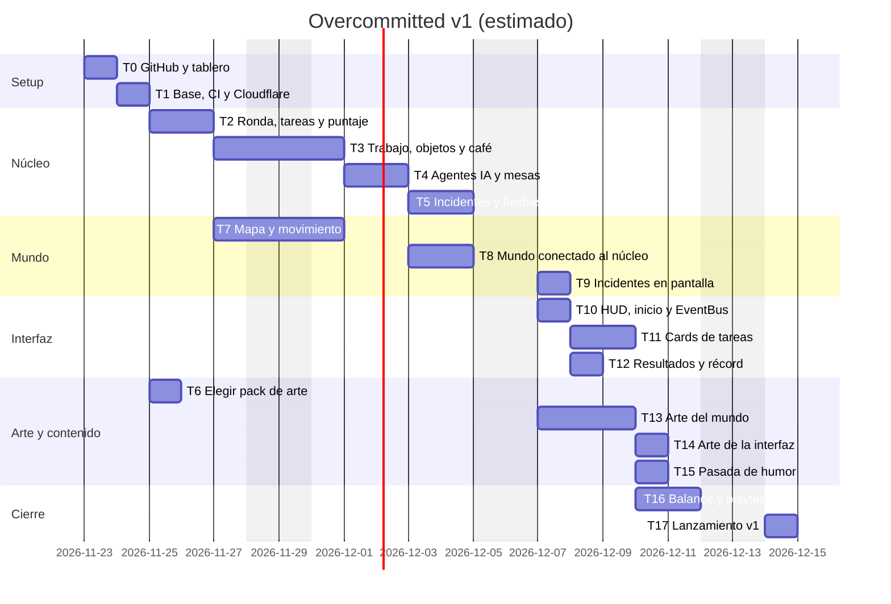

# Overcommitted v1 — Plan de implementación

> **Para quien ejecute (Claude Code):** cada tarea es un issue de GitHub. Hacé **una tarea por sesión** con el skill superpowers:executing-plans, siguiendo "Cómo se ejecuta cada tarea" (abajo). Los pasos usan checkboxes (`- [ ]`).

**Objetivo:** un juego de navegador para un jugador, publicado en una URL pública. Rondas de 5 minutos estilo Overcooked donde un dev buscando laburo malabarea tareas, agentes de IA e incendios.

**Arquitectura:** hay tres capas. El **núcleo** (`src/core`) es TypeScript puro y tiene todas las reglas, con tests. **Phaser** (`src/game`) dibuja el mundo y lee el teclado. **React** (`src/ui`) hace el HUD y las pantallas. Phaser llama al núcleo en cada frame. React no toca el núcleo directamente: recibe *snapshots* (fotos del estado) por el `EventBus`. El contenido (recetas, balance, textos, íconos) vive en `src/data`.

**Stack:** Phaser 4 (≥ 4.2.1), React 19, TypeScript, Vite, Vitest 5, ESLint 9 (flat config). Se publica en Cloudflare Pages y el CI corre en GitHub Actions.

**Spec:** `docs/2026-11-20-diseno-v1.md`. Leerla antes de cualquier tarea.

## Restricciones globales

- Todo **100% gratis**: hosting, assets, servicios. **Sin backend.**
- **Solo escritorio con teclado:** **WASD** mueve, **E** es la acción (tocar = agarrar/dejar, mantener = trabajar), **flechas ↑→↓←** solo para las secuencias de emergencia.
- **Solo español rioplatense con voseo.** Todos los textos del juego van en `src/data/texts.ts`, sin librería de i18n.
- **Código, nombres y mensajes de commit en inglés.** Issues, PRs y docs en español.
- Commits con formato Conventional Commits (`feat:`, `fix:`, `chore:`, `docs:`, `test:`). **Nunca** agregar el trailer `Co-Authored-By`.
- `src/core` **no importa** `phaser` ni `react` (lo valida ESLint).
- **Calidad de código de primer nivel** (pedido explícito de los dos):
  - **TypeScript estricto.** Prohibido `any`. Nada de `undefined` como valor ni tipo propio: la ausencia se modela con `null` explícito (`ItemType | null`), sin propiedades opcionales en tipos de dominio.
  - **Nada de `!` (non-null assertion)** en código de producción. Solo se permite en tests.
  - **Tipos e interfaces solo cuando hacen falta.** Los compartidos van en `src/core/types.ts`. Si un tipo se usa en un solo lugar, se infiere o se declara al lado de donde se usa. Nada de interfaces "por las dudas", ni interfaces con una sola implementación.
  - **No instalar dependencias** para lo que se resuelve en pocas líneas propias o con la plataforma (DOM, CSS, React, Phaser). Toda dependencia nueva se justifica en el PR.
  - **Estructura que escala por dominio:** `core` / `game` / `ui` / `data`, con el contenido como datos. Agregar una tarea, estación o incidente nuevo tiene que ser principalmente agregar datos, no tocar lógica en muchos lados.
- **Escala de 1 a 10k jugadores:** no hay servidor, cada partida corre en el navegador de quien juega y Cloudflare sirve archivos estáticos desde su CDN con tráfico ilimitado. Lo único que hay que cuidar es el **peso de carga**: sprites en spritesheets PNG chicos, nada de imágenes enormes, y Phaser en su propio chunk para que el navegador lo cachee.
- Todos los números de balance van **solo** en `src/data/balance.ts` y `src/data/recipes.ts`.
- Assets: **CC0**, o con licencia que permita explícitamente uso público gratuito. Cada uno se registra en `CREDITS.md`. **No usar LimeZu Modern Interiors free.**
- Contenido de la v1: 6 estaciones (notebook, 3 agentes IA, cafetera, estudio, entrevistas, LinkedIn), **3 mesas**, 5 tipos de tarea + la variante de entrevista en español, 3 incidentes. Ronda de **5 minutos**.
- **Estrellas: de 0 a 3.** La spec dice 1 a 3; el 0 es para puntajes por debajo del primer umbral, como en Overcooked.
- Cards de tareas **arriba a la izquierda**, una al lado de la otra, la más vieja a la izquierda.
- Nadie pushea a `main`. Una rama por issue, y se entra por PR con 1 aprobación del otro y el CI en verde. Merge por **rebase**: historia lineal que **conserva los commits atómicos**.
- **SDD (Spec-Driven Development):** la spec (`docs/2026-11-20-diseno-v1.md`) es la fuente de verdad. Si una tarea necesita un comportamiento que la spec no dice, o que la contradice, **primero se actualiza la spec** en un commit `docs:` del mismo PR, y después el código.
- **TDD:** toda lógica (núcleo, helpers puros de `game` y `ui`) se escribe test primero: rojo → verde → refactor. El código de Phaser y React se mantiene fino; la lógica que tenga sale a funciones puras testeadas. Un **smoke test e2e** (Playwright, desde T10) corre en el CI y verifica que el juego arranca y la ronda corre **antes de cada merge a producción**.
- **Commits atómicos por tema:** un comportamiento = su test + su código = un commit, y cada commit deja el repo compilando y con los tests en verde. Nada de un commit gigante por tarea. Los mensajes de cada tarea en este plan son orientativos del tema.

## Puntos para revisar con atención

Son los casos que la spec no menciona pero que más probablemente le pegan a quien juegue. Cada uno tiene su test o su verificación en la tarea indicada.

1. **Frames muy largos** (cambiaste de pestaña, la notebook se suspendió): la ronda no puede saltar segundos de golpe. `update` limita el `dt` a `maxDtMs`. Test en T2.
2. **Una tarea vence mientras su objeto está en la mano, en una mesa o dentro de un agente:** el objeto desaparece de todos lados y ese agente no alucina después. Test en T4.
3. **Puntaje y estrellas en los bordes:** el puntaje nunca es negativo, y por debajo del primer umbral son 0 estrellas. Tests en T2 y T3.
4. **Jugar de nuevo y arranque:** la segunda ronda empieza limpia, sin listeners del EventBus duplicados (StrictMode monta los efectos dos veces en desarrollo). El botón "Jugar" no hace nada hasta que la escena de Phaser esté lista. Smoke e2e en T10 y T12.
5. **Teclado:** las flechas y el espacio no scrollean la página, las teclas del juego no activan botones con foco, y E solo trabaja mientras está apretada. Verificación en T7 y T10.

---

## Cómo se ejecuta cada tarea (vale para todas)

1. **Humano:** toma un issue del tablero que no esté bloqueado, se lo asigna y lo mueve a "En curso".
2. **Humano:** `git switch main && git pull`, abre Claude Code en el repo y le pide "hacé la tarea N del plan".
3. **Claude:** crea la rama `<tipo>/<N>-<slug>` (ej: `feat/3-station-work`). Los tests de la tarea **no se escriben todos juntos**: se toma un comportamiento (uno o un grupo chico de tests), se ve en rojo, se implementa lo mínimo para el verde, se refactoriza y se hace **un commit atómico** con test + código. Así hasta cubrir la tarea, y al final `npm run check`. Commits en inglés, sin `Co-Authored-By`.
4. **Claude:** al terminar, **explica en español qué hizo, por qué se hace así y cómo funciona**. Deja escrito el texto de "Qué / Por qué / Cómo probarlo" para el PR.
5. **Humano:** `git push -u origin <rama>`, abre el PR con la plantilla (`Closes #N`) y mueve el issue a "En revisión".
6. **El otro:** lee el código, **juega el preview de Cloudflare**, comenta o aprueba.
7. **Autor:** *Rebase and merge*. El issue se cierra solo y Cloudflare publica a producción.

---

## Mapa de archivos

```
CLAUDE.md                     reglas del proyecto para Claude Code (T1)
CREDITS.md                    assets y licencias (T6)
.github/workflows/ci.yml      typecheck + lint + test + build (T1), job e2e (T10)
playwright.config.ts, e2e/    smoke test e2e (T10, T12)
.github/pull_request_template.md
vite.config.ts                Vite + Vitest (T1)
eslint.config.js              flat config + core sin phaser/react (T1)
src/
  main.tsx, App.tsx, PhaserGame.tsx     React raíz (template; App cambia en T10)
  core/
    types.ts       tipos compartidos y config (T2)
    state.ts       RoundState interno, createState, addScore (T2)
    scoring.ts     completionPoints, starsFor (T2)
    tasks.ts       spawn, vencimiento y borrado de tareas (T2, T4)
    work.ts        trabajo manteniendo E y café (T3)
    handoff.ts     agentes IA y mesas (T4)
    incidents.ts   incidentes y flechas (T5)
    round.ts       clase Round: API pública del núcleo + snapshot (T2–T5)
    fixtures.ts    config de test + helpers advance/hold (T2)
  data/
    recipes.ts, balance.ts, texts.ts, icons.ts   (T2)
  game/
    EventBus.ts    (template)
    events.ts      nombres de eventos y payloads (T10)
    main.ts        config de Phaser (T1, T7)
    layout.ts      mapa en tiles y estaciones (T7)
    interaction.ts findStationInRange (T7)
    player.ts      creación y movimiento del dev (T7)
    stationViews.ts dibujo de estaciones y estado (T8)
    arrowPrompt.ts secuencia de flechas en pantalla (T9)
    scenes/Office.ts única escena (T1, T7–T9)
  ui/
    ui.css, format.ts, useGameSnapshot.ts, Hud.tsx, StartScreen.tsx   (T10)
    cardSteps.ts, TaskCards.tsx                                        (T11)
    ResultsScreen.tsx, bestScore.ts                                    (T12)
```

## Línea de tiempo (estimada, tipo Gantt)

1 día = 1 sesión de 2–4 h de una persona. Mermaid asume paralelismo infinito; con dos personas puede estirarse un poco. Las dependencias son las reales. Cada issue se marca "bloqueado por" sus dependencias.



---

### Task 0: GitHub, organización y tablero (guía para humanos, sin código)

**Depende de:** nada. **La hacen los dos juntos**, con Claude guiando en vivo.

- [ ] **Paso 1: Crear la organización.** github.com → `+` → *New organization* → plan **Free** → nombre `overcommitted-game` (si está tomado, otro y avisar a Claude) → "My personal account".
- [ ] **Paso 2: Invitarla.** Org → *People* → *Invite member* → rol **Owner** (los dos son dueños por igual). Ella acepta el mail.
- [ ] **Paso 3: Crear el repo.** Org → *Repositories* → *New* → `overcommitted`, **Public**, **sin** README, .gitignore ni licencia, porque se sube la carpeta existente.
- [ ] **Paso 4: Subir la carpeta local (Claude, con tu OK).** En `/Users/nico/Developer/overcommitted`:
  ```bash
  git init -b main
  git add docs
  git commit -m "docs: add v1 design and implementation plan"
  git remote add origin https://github.com/overcommitted-game/overcommitted.git
  git push -u origin main
  ```
  Es el único push directo a `main` de todo el proyecto.
- [ ] **Paso 5: Opciones de merge.** Repo → *Settings* → *General* → *Pull Requests*: dejar **solo "Allow rebase merging"** (conserva los commits atómicos en una historia lineal), y activar **"Automatically delete head branches"** y **"Always suggest updating pull request branches"**.
- [ ] **Paso 6: Proteger `main`.** *Settings* → *Rules* → *Rulesets* → *New branch ruleset*:
  - nombre `main protegida`, *Enforcement*: **Active**, *Target*: **Default branch**, *Bypass list*: **vacía** (las reglas valen también para los owners);
  - reglas: **Restrict deletions**, **Block force pushes**, **Require linear history**, **Require a pull request before merging** con 1 aprobación, **Dismiss stale approvals when new commits are pushed** y **Require conversation resolution**.
  - *Require status checks* se agrega en T1, porque el check tiene que haber corrido una vez para poder elegirlo.
- [ ] **Paso 7: Tablero.** Org → *Projects* → *New project* → **Board** → "Overcommitted v1":
  - columnas *Por hacer / En curso / En revisión / Hecho*;
  - campos **Inicio** y **Fin** (tipo fecha);
  - nueva vista **Roadmap** usando Inicio y Fin: esa es la vista Gantt;
  - *Workflows*: auto-agregar issues del repo, item cerrado → Hecho, PR mergeado → Hecho.
- [ ] **Paso 8: Issues (Claude, con tu OK).** Con `gh`, un issue por tarea T1–T17:
  - el título es el de la tarea y el cuerpo "Ver `docs/2026-11-20-plan-v1.md`, Task N" con sus pasos como checklist;
  - labels `infra`, `núcleo`, `mundo`, `interfaz`, `arte`, `contenido`;
  - relaciones **"blocked by"** según el Gantt, y fechas Inicio/Fin estimadas en el tablero.
- [ ] **Paso 9: Clonar en la compu de ella.** `git clone https://github.com/overcommitted-game/overcommitted.git`. El `npm install` va después de T1.

**Listo cuando:** los dos ven el repo con `docs/`, `main` rechaza un push directo y el tablero muestra los 17 issues en la vista Roadmap.

---

### Task 1: Base del proyecto, CI y Cloudflare

**Depende de:** T0. Rama: `chore/1-project-base`.

**Archivos:**
- Copiar del template oficial `phaserjs/template-react-ts` (clonarlo con `--depth 1` en el scratchpad y copiar **solo** esto): `index.html`, `package.json`, `tsconfig.json`, `.gitignore`, `.editorconfig`, `public/favicon.png`, `src/main.tsx`, `src/App.tsx`, `src/PhaserGame.tsx`, `src/vite-env.d.ts`, `src/game/EventBus.ts`, `src/game/main.ts`.
- **No copiar:** `log.js` (manda telemetría a un servidor externo en cada `dev`/`build`), `vite/`, `.eslintrc.cjs`, `tsconfig.node.json`, `src/game/scenes/*`, `public/assets/*`, `public/style.css`, `screenshot.png`, `README.md`, `LICENSE`.
- Crear: `src/game/scenes/Office.ts`, `vite.config.ts`, `eslint.config.js`, `src/ui/ui.css`, `.nvmrc`, `CLAUDE.md`, `.github/workflows/ci.yml`, `.github/pull_request_template.md`, `LICENSE`, `README.md`.

**Interfaces:**
- Produce: `npm run dev | build | typecheck | lint | test | check`. La escena `Office` (key `'Office'`) emite `EventBus.emit('current-scene-ready', this)` en `create()`.

- [ ] **Paso 1: `package.json`.**
  - `name: "overcommitted"`, `private: true`, `version: "0.1.0"`, `license: "MIT"`. Sacar `repository`, `author`, `homepage`, `bugs`, `keywords` y `licenseUrl`.
  - `phaser: "^4.2.1"`. Sacar `terser`. Agregar `vitest: "^5"` en dev.
  - Scripts: `dev: "vite"`, `build: "vite build"`, `typecheck: "tsc --noEmit"`, `lint: "eslint ."`, `test: "vitest run"`, `check: "npm run typecheck && npm run lint && npm test && npm run build"`.
- [ ] **Paso 2: Configs.**
  - `vite.config.ts` con `defineConfig` de `vitest/config`: `base: './'`, `plugins: [react()]`, `test: { include: ['src/**/*.test.ts'], passWithNoTests: true }`.
  - `tsconfig.json`: sacar `references`, incluir `["src", "vite.config.ts"]` y sumar `"noUncheckedIndexedAccess": true` y `"noImplicitOverride": true` a lo que ya trae el template (`strict` etc.).
  - `vite.config.ts`: `build.rollupOptions.output.manualChunks: { phaser: ['phaser'] }`, para que Phaser quede en su propio chunk cacheable.
  - `.nvmrc`: `24`.
  - `eslint.config.js` (flat):
    - `@eslint/js` recommended + `typescript-eslint` **`strictTypeChecked`** (con `parserOptions.projectService: true`), `react-hooks` y `react-refresh`, ignorando `dist`;
    - reglas: `@typescript-eslint/no-explicit-any: error`, `@typescript-eslint/no-non-null-assertion: error` (apagada en `**/*.test.ts`), y `no-restricted-imports` que prohíba `phaser` y `react` en `src/core/**`.
- [ ] **Paso 3: Esqueleto.**
  - `src/game/main.ts`: `width: 640`, `height: 360`, `pixelArt: true`, `backgroundColor: '#1d1d2b'`, `physics: { default: 'arcade' }`, `scale: { mode: Phaser.Scale.FIT, autoCenter: Phaser.Scale.CENTER_BOTH }`, `scene: [Office]`.
  - `Office` solo muestra "Overcommitted" centrado y emite `current-scene-ready`.
  - `App.tsx` renderiza solo `<PhaserGame ref={phaserRef} />`.
  - `index.html`: `lang="es"`, `<title>Overcommitted</title>`, sin el link a `style.css`.
  - `src/ui/ui.css` (importado en `main.tsx`): `html, body, #root` a 100% de alto, `margin: 0`, `overflow: hidden`, fondo negro.
- [ ] **Paso 4: Instalar y verificar.** `npm install`.
  - Si sale `ESTRICTALLOWSCRIPTS` (la compu de Nico exige aprobar scripts de instalación), aprobar solo lo conocido (`npm install-scripts approve esbuild`) y dejarlo en `allowScripts`. Nunca `--dangerously-allow-all-scripts`.
  - Correr `npm run check` → todo pasa.
  - Correr `npm run dev` → se ve "Overcommitted" centrado y escalado al achicar la ventana.
- [ ] **Paso 5: `CLAUDE.md`**, con estas reglas (en español):
  - leer la spec y el plan antes de cada tarea;
  - las capas y la regla de que `src/core` no importa `phaser`/`react`;
  - Phaser↔React solo por los eventos de `src/game/events.ts`;
  - textos solo en `src/data/texts.ts` (voseo) y balance solo en `src/data/balance.ts`/`recipes.ts`;
  - tests del núcleo con Vitest junto al archivo (`*.test.ts`);
  - `npm run check` antes de commitear;
  - **SDD:** la spec manda; si hace falta un comportamiento nuevo o distinto, primero se actualiza la spec (commit `docs:`) y después el código;
  - **TDD:** test primero, de a un comportamiento (rojo → verde → refactor). La lógica de Phaser y React sale a funciones puras testeadas;
  - **commits atómicos por tema**, cada uno compilando y con los tests en verde, nunca un commit gigante; Conventional Commits en inglés, **nunca `Co-Authored-By`**;
  - nunca pushear a `main`, una rama por issue `<tipo>/<N>-<slug>`;
  - **al terminar cada tarea, explicar en español qué se hizo, por qué y cómo funciona**, porque los dos están aprendiendo;
  - las reglas de calidad de las Restricciones globales copiadas tal cual: sin `any`, ausencia con `null` y no `undefined`, sin `!` fuera de tests, tipos solo cuando hacen falta, estructura por dominio con el contenido como datos;
  - no instalar dependencias si se resuelve en pocas líneas o con la plataforma, y justificar cada una en el PR;
  - assets solo gratis, registrados en `CREDITS.md`;
  - preferir la solución más simple que funcione.
- [ ] **Paso 6: `.github/pull_request_template.md`** con secciones `## Qué`, `## Por qué`, `## Cómo probarlo` (link del preview y qué jugar) y checklist (`npm run check` pasa, `Closes #`).
- [ ] **Paso 7: `.github/workflows/ci.yml`.** Corre en `pull_request` y en `push` a `main`, con un job llamado **`check`** en `ubuntu-latest`. Pasos: `actions/checkout@v7`, `actions/setup-node@v7` (`node-version-file: .nvmrc`, `cache: npm`), `npm ci`, `npm run typecheck`, `npm run lint`, `npm test`, `npm run build`.
- [ ] **Paso 8:** `LICENSE` MIT con los nombres de los dos. `README.md` de 5 líneas: qué es, `npm install`, `npm run dev`, link a `docs/`.
- [ ] **Paso 9: Commits atómicos**, cada uno con `npm run check` en verde:
  1. `chore: import phaser react template without telemetry` (archivos del template + escena `Office` + App mínima);
  2. `chore: configure strict typescript, eslint and vitest`;
  3. `ci: add github actions check workflow`;
  4. `docs: add claude rules, pr template, license and readme`.

  Después, la explicación.
- [ ] **Paso 10 (humano, guiado): Cloudflare Pages.**
  1. dash.cloudflare.com → crear cuenta gratis.
  2. *Workers & Pages* → *Create* → **Pages** → *Connect to Git*. Autorizar la app de GitHub **solo** para `overcommitted-game/overcommitted`.
  3. Build command `npm run build`, output `dist`, production branch `main`, previews para todas las demás ramas. Nombre del proyecto `overcommitted`, que da `overcommitted.pages.dev`.
  4. *Si el panel ya no ofrece Pages y solo Workers:* agregar `wrangler.jsonc` con `assets: { directory: "./dist", not_found_handling: "single-page-application" }`, deploy command `npx wrangler deploy` y, para ramas que no son main, `npx wrangler versions upload` (genera la URL de preview).
- [ ] **Paso 11 (humano):** push, abrir el PR y verificar:
  - el CI queda verde;
  - Cloudflare comenta el link de preview en el PR y al abrirlo se ve "Overcommitted".
  
  Después ella revisa y aprueba, se hace rebase and merge y se agrega **Require status checks → `check`** al ruleset de `main`.

**Listo cuando:** `https://overcommitted.pages.dev` muestra la escena y un PR con el CI en rojo no se puede mergear.

---

### Task 2: Núcleo — ronda, tareas y puntaje

**Depende de:** T1. Rama: `feat/2-core-round`.

**Archivos:**
- Crear: `src/core/{types,state,scoring,tasks,round,fixtures}.ts`, `src/data/{recipes,balance,texts,icons}.ts`.
- Tests: `src/core/scoring.test.ts`, `src/core/round.test.ts`.

**Interfaces (producidas; las usan todas las tareas siguientes):**

```ts
// src/core/types.ts
export type StationType = 'notebook' | 'agent' | 'coffee' | 'study' | 'interview' | 'linkedin' | 'counter';
export type ItemType = 'prompt' | 'pr' | 'englishNotes' | 'frameworkNotes';
export type TaskKind = 'clientBug' | 'sideFeature' | 'englishInterview' | 'spanishInterview' | 'techTest' | 'jobApplication';
export type IncidentKind = 'fire' | 'npmVuln' | 'hallucination';
export type Arrow = 'up' | 'right' | 'down' | 'left';
export type ArrowResult = 'progress' | 'reset' | 'resolved' | 'ignored';

export interface Item { type: ItemType; taskId: number }
export interface Station { id: string; type: StationType }          // ej: { id: 'agent-2', type: 'agent' }
export type Step =
  | { kind: 'work'; station: 'notebook' | 'study' | 'interview' | 'linkedin'; workMs: number; needs: ItemType | null; gives: ItemType | null }
  | { kind: 'agent'; needs: ItemType; processMs: number; gives: ItemType };
export interface Recipe { steps: Step[]; timeLimitMs: number; points: number }

export interface Balance {
  durationMs: number; maxDtMs: number;
  initialTasks: number; spawnEveryMs: number; maxPendingTasks: number;
  taskWeights: Record<TaskKind, number>;
  speedBonusMax: number; expirePenalty: number;
  agentReadyWindowMs: number;
  coffee: { workMs: number; multiplier: number; durationMs: number };
  incidents: {
    graceMs: number; drainPerSec: number;
    fire: { meanIntervalMs: number; sequenceLength: number };
    npmVuln: { meanIntervalMs: number; sequenceLength: number };
    hallucination: { sequenceLength: number };
  };
  starThresholds: [number, number, number];
}
export interface RoundConfig { balance: Balance; recipes: Record<TaskKind, Recipe>; stations: Station[]; rng: () => number }

export interface TaskView { id: number; kind: TaskKind; stepIndex: number; stepProgress: number; remainingMs: number; timeLimitMs: number }
export interface StationView {
  id: string; type: StationType;
  item: Item | null;                                                  // mesa: lo apoyado; agente: lo que procesa o el resultado listo
  agent: { state: 'idle' | 'working' | 'ready'; progress: number } | null;   // solo agentes
  incident: { kind: IncidentKind; sequence: Arrow[]; typed: number } | null;
  workProgress: number | null;                                        // 0..1 del trabajo en curso en esta estación
}
export interface GameSnapshot {
  phase: 'playing' | 'ended'; elapsedMs: number; durationMs: number;
  score: number;                       // Math.round del interno, nunca < 0
  held: Item | null; speedMultiplier: number;
  tasks: TaskView[];                   // pendientes, de la más vieja a la más nueva
  stations: StationView[];
  stats: { completed: number; expired: number; incidentsResolved: number };
}
export interface RoundSummary { score: number; stars: 0 | 1 | 2 | 3; completed: number; expired: number; incidentsResolved: number }
```

- `state.ts`:
  - `interface RoundState`: `config`, `elapsedMs`, `phase`, `score` (float), `nextTaskId`, `spawnTimerMs`, `tasks: TaskState[]`, `held`, `buffMs`, `coffeeProgressMs`, `agents: Record<string, AgentState>`, `counters: Record<string, Item | null>`, `incidents: Record<string, IncidentState | null>`, `stats`.
  - `TaskState = { id, kind, stepIndex, stepProgressMs, remainingMs }`.
  - `AgentState = { status: 'idle'|'working'|'ready', item: Item | null, timerMs: number }`.
  - `IncidentState = { kind, sequence: Arrow[], typed: number }`.
  - `createState(config): RoundState`: arranca agentes en idle, mesas y incidentes en null para cada estación de ese tipo.
  - `addScore(state, delta): void` nunca deja `score < 0`.
- `scoring.ts`:
  - `completionPoints(points, remainingMs, timeLimitMs, speedBonusMax): number` = `points + Math.round(points * speedBonusMax * remainingMs / timeLimitMs)`.
  - `starsFor(score, thresholds): 0|1|2|3` = cantidad de umbrales alcanzados (`>=`).
- `tasks.ts`:
  - `spawnTask(state, kind): number`: devuelve el id, que arranca en 1; `remainingMs = timeLimitMs`.
  - `spawnScheduledTasks(state, dtMs)`: cada `spawnEveryMs` y con tope `maxPendingTasks`, elige el tipo con `taskWeights` y `rng`.
  - `expireTasks(state, dtMs)`: descuenta tiempo; si una tarea llega a ≤ 0, `addScore(-expirePenalty)`, `stats.expired++` y se borra.
  - `removeTask(state, taskId)`: único lugar que saca una tarea (T4 le agrega el borrado de sus objetos).
- `round.ts`:
  - `createRound(config): Round`; el constructor hace `initialTasks` spawns.
  - `class Round { update(dtMs): void; spawnTask(kind): number; snapshot(): GameSnapshot; summary(): RoundSummary }`.
  - `update`: `dt = Math.min(dtMs, maxDtMs)`; si `phase === 'ended'` no hace nada; suma tiempo, spawnea y vence tareas; al llegar a `durationMs` pasa a `ended` y fija `elapsedMs = durationMs`.
- `fixtures.ts` (solo para tests):
  - `makeConfig(overrides?: Partial<Balance>, rng = () => 0.99): RoundConfig` con estaciones `notebook-1, agent-1, agent-2, agent-3, coffee-1, study-1, interview-1, linkedin-1, counter-1, counter-2, counter-3`.
  - Balance del fixture: `durationMs 300000, maxDtMs 100, initialTasks 0, spawnEveryMs 1e9, maxPendingTasks 5`, pesos todos en 1, `speedBonusMax 0.5, expirePenalty 20, agentReadyWindowMs 10000`, `coffee {2000, 1.5, 20000}`, `incidents { graceMs 0, drainPerSec 2, fire {1e12, 4}, npmVuln {1e12, 4}, hallucination {3} }`, `starThresholds [100, 200, 300]`.
  - Recetas propias del fixture (las mismas de la tabla de abajo).
  - Helper: `advance(round, ms)` llama `update(100)` en loop. El helper `hold` lo agrega T3, porque usa `work`.
- Data (valores iniciales, se ajustan en T16). Recetas:

  | kind | pasos | límite | puntos |
  |---|---|---|---|
  | `clientBug` | work notebook 3000 → `prompt`; agent `prompt` 8000 → `pr`; work notebook 2000 needs `pr` | 70000 | 60 |
  | `sideFeature` | igual que `clientBug` | 80000 | 40 |
  | `englishInterview` | work study 4000 → `englishNotes`; work interview 4000 needs `englishNotes` | 60000 | 50 |
  | `spanishInterview` | work interview 4000 | 45000 | 30 |
  | `techTest` | work study 4000 → `frameworkNotes`; work notebook 3000 needs `frameworkNotes` | 60000 | 50 |
  | `jobApplication` | work linkedin 1500 | 30000 | 10 |

  `BALANCE`:
  - ronda: `durationMs 300000, maxDtMs 100, initialTasks 2, spawnEveryMs 18000, maxPendingTasks 5`;
  - pesos: `jobApplication 3, clientBug 2`, el resto 1;
  - puntaje y agentes: `speedBonusMax 0.5, expirePenalty 20, agentReadyWindowMs 10000`;
  - café: `{2000, 1.5, 20000}`;
  - incidentes: `{ graceMs 20000, drainPerSec 2, fire {60000, 6}, npmVuln {75000, 5}, hallucination {4} }`;
  - `starThresholds [150, 350, 600]`.

  `texts.ts` exporta `TEXTS` con:
  - `title`, `tagline`, `controls: string[]`, `startButton`, `replayButton`;
  - `stations: Record<StationType,string>`, `items: Record<ItemType,string>`, `tasks: Record<TaskKind,string>`, `incidents: Record<IncidentKind,string>`;
  - `results: { title, completed, expired, incidents, best, newRecord, byStars: [string,string,string,string] }`.
  
  Textos iniciales con humor y voseo; se pulen en T15. `icons.ts` exporta `ICONS: Record<StationType | ItemType, string>` con emojis provisorios.

- [ ] **Paso 1: Tests que fallan** (`scoring.test.ts` + `round.test.ts`):

```ts
test('completionPoints adds a bonus proportional to remaining time', () => {
  expect(completionPoints(10, 30000, 30000, 0.5)).toBe(15);
  expect(completionPoints(10, 0, 30000, 0.5)).toBe(10);
  expect(completionPoints(60, 35000, 70000, 0.5)).toBe(75);
});
test('starsFor counts reached thresholds', () => {
  expect([99, 100, 250, 300, 999].map(s => starsFor(s, [100, 200, 300]))).toEqual([0, 1, 2, 3, 3]);
});
test('round ends exactly at duration', () => {
  const r = createRound(makeConfig({ durationMs: 1000 }));
  advance(r, 1500);
  expect(r.snapshot()).toMatchObject({ phase: 'ended', elapsedMs: 1000 });
});
test('huge frame deltas are clamped to maxDtMs', () => {
  const r = createRound(makeConfig());
  r.update(5000);
  expect(r.snapshot().elapsedMs).toBe(100);
});
test('spawns initial tasks, then on schedule, up to the max', () => {
  const r = createRound(makeConfig({ initialTasks: 2, spawnEveryMs: 1000, maxPendingTasks: 3 }));
  expect(r.snapshot().tasks).toHaveLength(2);
  advance(r, 1000); expect(r.snapshot().tasks).toHaveLength(3);
  advance(r, 2000); expect(r.snapshot().tasks).toHaveLength(3);
});
test('expired task is removed, counted, and score stays >= 0', () => {
  const r = createRound(makeConfig());
  r.spawnTask('jobApplication');
  advance(r, 30000);
  expect(r.snapshot()).toMatchObject({ tasks: [], score: 0, stats: { expired: 1 } });
});
test('tasks are listed oldest first with remaining time', () => {
  const r = createRound(makeConfig());
  const a = r.spawnTask('jobApplication'); advance(r, 1000); const b = r.spawnTask('clientBug');
  const [ta, tb] = r.snapshot().tasks;
  expect([ta.id, tb.id]).toEqual([a, b]);
  expect(ta).toMatchObject({ remainingMs: 29000, timeLimitMs: 30000, stepIndex: 0, stepProgress: 0 });
});
test('summary reports stars from final score', () => {
  expect(createRound(makeConfig()).summary()).toEqual({ score: 0, stars: 0, completed: 0, expired: 0, incidentsResolved: 0 });
});
```

- [ ] **Paso 2:** `npx vitest run src/core` → FALLA (los módulos no existen).
- [ ] **Paso 3:** implementar tipos, state, scoring, tasks, round, fixtures y data según las Interfaces.
- [ ] **Paso 4:** `npx vitest run src/core` → PASA. `npm run check` → PASA.
- [ ] **Paso 5:** commit `feat(core): add round clock, task spawning and scoring` + explicación.

---

### Task 3: Núcleo — trabajo en estaciones, objetos y café

**Depende de:** T2. Rama: `feat/3-station-work`.

**Archivos:** Crear `src/core/work.ts`, `src/core/work.test.ts`. Modificar `src/core/round.ts` y `src/core/fixtures.ts`, donde se agrega `hold(round, stationId, ms)`: por cada paso de 100 ms llama `work(id, 100)` y después `update(100)`.

**Interfaces:**
- Usa: `RoundState`, `addScore`, `completionPoints`, `removeTask`.
- Produce:
  - `Round.work(stationId: string, dtMs: number): void`, con el mismo clamp de `maxDtMs`; ignorado si `phase === 'ended'` o si la estación no existe.
  - El snapshot llena `held`, `speedMultiplier`, `TaskView.stepIndex/stepProgress` y `StationView.workProgress`.
- **Regla para elegir la tarea** (spec §5.4):
  1. Si tenés algo en la mano, trabajás la tarea de ese objeto, siempre que su paso actual sea `work` en esta estación con `needs === held.type`.
  2. Si tenés las manos vacías, trabajás la tarea **más vieja** cuyo paso actual sea `work` en esta estación con `needs === null`.
  3. Si no hay ninguna, no pasa nada.
- **Avance:** el progreso suma `dt * speedMultiplier` y queda guardado en la tarea, aunque te vayas de la estación. Al completar el paso:
  - si el paso consume (`needs`), se vacía la mano;
  - si el paso produce (`gives`), `held = { type: gives, taskId }`;
  - avanza `stepIndex`;
  - si era el último paso: `addScore(completionPoints(...))`, `stats.completed++` y `removeTask`.
- **Café:** `work` en `coffee` acumula `coffeeProgressMs` hasta `coffee.workMs` (se puede tener algo en la mano). Al completarse: `buffMs = coffee.durationMs` y el progreso vuelve a 0. `speedMultiplier` vale `coffee.multiplier` mientras `buffMs > 0`, y si no, 1. `update` descuenta `buffMs`.

- [ ] **Paso 1: Tests que fallan:**

```ts
test('single-step task completes after workMs at its station', () => {
  const r = createRound(makeConfig()); r.spawnTask('jobApplication');
  hold(r, 'linkedin-1', 1400); expect(r.snapshot().tasks).toHaveLength(1);
  hold(r, 'linkedin-1', 100);
  const s = r.snapshot();
  expect(s.tasks).toHaveLength(0); expect(s.stats.completed).toBe(1);
  expect(s.score).toBe(15); // 10 + round(10 * 0.5 * 28600 / 30000)
});
test('first step gives an item and advances the task', () => {
  const r = createRound(makeConfig()); const id = r.spawnTask('clientBug');
  hold(r, 'notebook-1', 3000);
  expect(r.snapshot().held).toEqual({ type: 'prompt', taskId: id });
  expect(r.snapshot().tasks[0].stepIndex).toBe(1);
});
test('cannot start a new task with full hands', () => {
  const r = createRound(makeConfig()); r.spawnTask('englishInterview'); r.spawnTask('techTest');
  hold(r, 'study-1', 4000); hold(r, 'study-1', 4000);
  expect(r.snapshot().tasks.map(t => t.stepIndex)).toEqual([1, 0]);
});
test('held item finishes its own task', () => {
  const r = createRound(makeConfig()); r.spawnTask('englishInterview');
  hold(r, 'study-1', 4000); hold(r, 'interview-1', 4000);
  expect(r.snapshot()).toMatchObject({ held: null, tasks: [], stats: { completed: 1 } });
});
test('empty hands work the oldest eligible task', () => {
  const r = createRound(makeConfig()); const a = r.spawnTask('jobApplication'); r.spawnTask('jobApplication');
  hold(r, 'linkedin-1', 1500);
  expect(r.snapshot().tasks.map(t => t.id)).not.toContain(a);
});
test('progress is kept when walking away', () => {
  const r = createRound(makeConfig()); r.spawnTask('jobApplication');
  hold(r, 'linkedin-1', 1000); hold(r, 'study-1', 500);
  expect(r.snapshot().tasks[0].stepProgress).toBeCloseTo(1000 / 1500);
  hold(r, 'linkedin-1', 500); expect(r.snapshot().tasks).toHaveLength(0);
});
test('coffee speeds up work and wears off', () => {
  const r = createRound(makeConfig()); r.spawnTask('jobApplication');
  hold(r, 'coffee-1', 2000); expect(r.snapshot().speedMultiplier).toBe(1.5);
  hold(r, 'linkedin-1', 1000); expect(r.snapshot().tasks).toHaveLength(0);
  advance(r, 20000); expect(r.snapshot().speedMultiplier).toBe(1);
});
test('completing then expiring never drops score below zero', () => {
  const r = createRound(makeConfig()); r.spawnTask('jobApplication'); r.spawnTask('jobApplication');
  hold(r, 'linkedin-1', 1500); advance(r, 30000);
  expect(r.snapshot().score).toBe(0);
});
test('work is ignored after the round ends and on unknown stations', () => {
  const r = createRound(makeConfig({ durationMs: 1000 })); r.spawnTask('jobApplication');
  r.work('nope', 100); advance(r, 1000); hold(r, 'linkedin-1', 1500);
  expect(r.snapshot().stats.completed).toBe(0);
});
```

- [ ] **Paso 2:** `npx vitest run src/core/work.test.ts` → FALLA.
- [ ] **Paso 3:** implementar `work(state, stationId, dtMs)` en `work.ts`, delegar desde `Round.work` y completar el snapshot.
- [ ] **Paso 4:** `npx vitest run src/core` → PASA. `npm run check` → PASA.
- [ ] **Paso 5:** commit `feat(core): add station work, carried items and coffee buff` + explicación.

---

### Task 4: Núcleo — agentes IA y mesas

**Depende de:** T3. Rama: `feat/4-agents-counters`.

**Archivos:** Crear `src/core/handoff.ts`, `src/core/handoff.test.ts`. Modificar `src/core/tasks.ts` (`removeTask`) y `src/core/round.ts`.

**Interfaces:**
- Produce: `Round.interact(stationId: string): void` (tocar E), que se ignora si terminó la ronda o la estación tiene un incidente (el incidente llega en T5; dejar el chequeo listo). También produce `updateAgents(state, dtMs)`, que se llama desde `update`, y el snapshot completa `StationView.item/agent`.
- **Agente:**
  - **idle** y en la mano un objeto cuya tarea tiene como paso actual `agent` con `needs === held.type` → se suelta: `working`, `timerMs = processMs`.
  - **working** → cuando `timerMs` llega a 0 pasa a `ready`, el item pasa a ser `{ type: gives, taskId }` y `timerMs = agentReadyWindowMs`.
  - **ready** con las manos vacías → se agarra el resultado, avanza `stepIndex` y el agente vuelve a idle.
  - **ready** sin que nadie lo retire hasta que `timerMs` llega a 0 → **alucina**: el item se pierde, la tarea vuelve a `stepIndex 0` con progreso 0, el agente queda idle y se llama `startIncident(state, 'hallucination', stationId)`.
  - En T4, `startIncident` es un stub en `incidents.ts` que solo hace `state.incidents[id] = { kind, sequence: [], typed: 0 }`. T5 lo completa.
- **Mesa:** con algo en la mano y la mesa vacía → apoyás el objeto. Con las manos vacías y algo en la mesa → lo agarrás. Cualquier otro caso → nada.
- **`removeTask`:** además de sacar la tarea, borra su objeto de la mano, de las mesas y de los agentes (que vuelven a idle).

- [ ] **Paso 1: Tests que fallan:**

```ts
function promptInHand(overrides?: Partial<Balance>) {
  const r = createRound(makeConfig(overrides)); const id = r.spawnTask('clientBug');
  hold(r, 'notebook-1', 3000); return { r, id };
}
const station = (r: Round, id: string) => r.snapshot().stations.find(s => s.id === id)!;

test('drops a matching item into an idle agent', () => {
  const { r } = promptInHand(); r.interact('agent-1');
  expect(r.snapshot().held).toBeNull();
  expect(station(r, 'agent-1').agent).toMatchObject({ state: 'working' });
});
test('agent rejects items that are not its next step', () => {
  const r = createRound(makeConfig()); r.spawnTask('englishInterview'); hold(r, 'study-1', 4000);
  r.interact('agent-1'); expect(r.snapshot().held?.type).toBe('englishNotes');
});
test('agent result is collected with empty hands', () => {
  const { r, id } = promptInHand(); r.interact('agent-1'); advance(r, 8000);
  expect(station(r, 'agent-1').agent?.state).toBe('ready');
  r.interact('agent-1');
  expect(r.snapshot().held).toEqual({ type: 'pr', taskId: id });
  expect(r.snapshot().tasks[0].stepIndex).toBe(2);
});
test('full bug flow completes the task', () => {
  const { r } = promptInHand(); r.interact('agent-1'); advance(r, 8000); r.interact('agent-1');
  hold(r, 'notebook-1', 2000); expect(r.snapshot().stats.completed).toBe(1);
});
test('unattended ready agent hallucinates and resets its task', () => {
  const { r } = promptInHand(); r.interact('agent-1'); advance(r, 8000 + 10000);
  const a = station(r, 'agent-1');
  expect(a).toMatchObject({ item: null, agent: { state: 'idle' }, incident: { kind: 'hallucination' } });
  expect(r.snapshot().tasks[0]).toMatchObject({ stepIndex: 0, stepProgress: 0 });
});
test('counter stores one item and gives it back', () => {
  const { r, id } = promptInHand();
  r.interact('counter-1'); expect(r.snapshot().held).toBeNull();
  expect(station(r, 'counter-1').item).toEqual({ type: 'prompt', taskId: id });
  r.interact('counter-1'); expect(r.snapshot().held?.type).toBe('prompt');
});
test('full counter refuses a second item', () => {
  const { r } = promptInHand(); r.interact('counter-1');
  r.spawnTask('clientBug'); hold(r, 'notebook-1', 3000); r.interact('counter-1');
  expect(r.snapshot().held).not.toBeNull();
});
test('expiring task removes its item from hand, counter and agent', () => {
  const inHand = promptInHand(); advance(inHand.r, 70000);
  expect(inHand.r.snapshot().held).toBeNull();
  const onCounter = promptInHand(); onCounter.r.interact('counter-1'); advance(onCounter.r, 70000);
  expect(station(onCounter.r, 'counter-1').item).toBeNull();
  const inAgent = promptInHand({ agentReadyWindowMs: 1e9 }); // que no alucine antes de vencer
  inAgent.r.interact('agent-1'); advance(inAgent.r, 70000);
  expect(station(inAgent.r, 'agent-1')).toMatchObject({ item: null, agent: { state: 'idle' }, incident: null });
});
```

- [ ] **Paso 2:** `npx vitest run src/core/handoff.test.ts` → FALLA.
- [ ] **Paso 3:** implementar `interact` y `updateAgents` en `handoff.ts`, extender `removeTask` y agregar el stub de `startIncident`.
- [ ] **Paso 4:** `npx vitest run src/core` → PASA. `npm run check` → PASA.
- [ ] **Paso 5:** commit `feat(core): add ai agents, hallucinations and counters` + explicación.

---

### Task 5: Núcleo — incidentes y secuencias de flechas

**Depende de:** T4. Rama: `feat/5-incidents`.

**Archivos:** Modificar `src/core/incidents.ts`, `src/core/round.ts` y `src/core/work.ts` (bloqueo). Crear `src/core/incidents.test.ts`.

**Interfaces:**
- Produce:
  - `startIncident(state, kind, stationId): boolean`: false si esa estación ya tiene un incidente. Genera la secuencia con `sequenceLength` del tipo, con flechas `['up','right','down','left'][Math.floor(rng() * 4)]`.
  - `Round.spawnIncident(kind, stationId): boolean`.
  - `Round.inputArrow(stationId, arrow): ArrowResult`.
  - `updateIncidents(state, dtMs)`, llamado desde `update`.
- **Bloqueo:** `work` e `interact` se ignoran en una estación con incidente.
- **Drenaje:** cada incidente activo resta `drainPerSec * dt / 1000` con `addScore`.
- **Aleatorios:** solo después de `graceMs` y solo en estaciones `notebook` sin incidente. Por frame, primero se prueba `fire` y después `npmVuln`: `rng() < dt / meanIntervalMs` → `startIncident`.
- **Flechas:**
  - estación sin incidente → `'ignored'`;
  - flecha correcta → `typed++`, devuelve `'progress'`, o `'resolved'` si completó la secuencia (incidente a null, `stats.incidentsResolved++`);
  - flecha incorrecta → `typed = 0`, devuelve `'reset'`.

- [ ] **Paso 1: Tests que fallan:**

```ts
test('incident blocks work at its station', () => {
  const r = createRound(makeConfig()); r.spawnTask('clientBug'); r.spawnIncident('fire', 'notebook-1');
  hold(r, 'notebook-1', 3000); expect(r.snapshot().held).toBeNull();
});
test('active incident drains score per second', () => {
  const r = createRound(makeConfig()); r.spawnTask('jobApplication'); hold(r, 'linkedin-1', 1500);
  const before = r.snapshot().score; r.spawnIncident('fire', 'notebook-1'); advance(r, 1000);
  expect(r.snapshot().score).toBe(before - 2);
});
test('correct sequence resolves the incident', () => {
  const r = createRound(makeConfig()); r.spawnIncident('fire', 'notebook-1');
  const seq = r.snapshot().stations.find(s => s.id === 'notebook-1')!.incident!.sequence;
  expect(seq).toHaveLength(4);
  const results = seq.map(a => r.inputArrow('notebook-1', a));
  expect(results.at(-1)).toBe('resolved');
  expect(r.snapshot().stats.incidentsResolved).toBe(1);
});
test('wrong arrow resets the sequence', () => {
  const r = createRound(makeConfig()); r.spawnIncident('fire', 'notebook-1');
  const seq = r.snapshot().stations.find(s => s.id === 'notebook-1')!.incident!.sequence;
  r.inputArrow('notebook-1', seq[0]);
  const wrong = (['up', 'right', 'down', 'left'] as const).find(a => a !== seq[1])!;
  expect(r.inputArrow('notebook-1', wrong)).toBe('reset');
  expect(r.snapshot().stations.find(s => s.id === 'notebook-1')!.incident!.typed).toBe(0);
});
test('arrows on a station without incident are ignored', () => {
  expect(createRound(makeConfig()).inputArrow('notebook-1', 'up')).toBe('ignored');
});
test('resolving a hallucination frees the agent', () => {
  const r = createRound(makeConfig()); r.spawnTask('clientBug'); hold(r, 'notebook-1', 3000);
  r.interact('agent-1'); advance(r, 18000);
  const seq = r.snapshot().stations.find(s => s.id === 'agent-1')!.incident!.sequence;
  expect(seq).toHaveLength(3);
  seq.forEach(a => r.inputArrow('agent-1', a));
  hold(r, 'notebook-1', 3000); r.interact('agent-1');
  expect(r.snapshot().stations.find(s => s.id === 'agent-1')!.agent?.state).toBe('working');
});
test('random incidents respect grace period and one per station', () => {
  const inc = { graceMs: 1000, drainPerSec: 2, fire: { meanIntervalMs: 1, sequenceLength: 4 },
    npmVuln: { meanIntervalMs: 1, sequenceLength: 4 }, hallucination: { sequenceLength: 3 } };
  const r = createRound(makeConfig({ incidents: inc }, () => 0));
  advance(r, 900);
  expect(r.snapshot().stations.every(s => s.incident === null)).toBe(true);
  advance(r, 500);
  const withIncident = r.snapshot().stations.filter(s => s.incident);
  expect(withIncident.map(s => [s.id, s.incident!.kind])).toEqual([['notebook-1', 'fire']]);
});
```

- [ ] **Paso 2:** `npx vitest run src/core/incidents.test.ts` → FALLA.
- [ ] **Paso 3:** implementar según las Interfaces.
- [ ] **Paso 4:** `npx vitest run src/core` → PASA. `npm run check` → PASA.
- [ ] **Paso 5:** commit `feat(core): add incidents with arrow sequences` + explicación.

---

### Task 6: Elegir el pack de arte (humano + Claude)

**Depende de:** T1. Rama: `chore/6-art-pack`. No tiene código.

- [ ] **Paso 1:** buscar candidatos en itch.io y kenney.nl. Criterios:
  - licencia **CC0**, o texto explícito de uso libre en un juego público gratuito;
  - interior moderno de oficina o depto en vista de arriba;
  - **personaje con animación de caminar en 4 direcciones** (puede ser de otro pack CC0 con la misma estética);
  - **tiles de 16×16** de preferencia.
  
  Para empezar: packs CC0 de Kenney y MetroCity (jik-a-4).
- [ ] **Paso 2:** para cada candidato, Claude lee la página de licencia y anota el texto exacto. Los dos eligen por estética.
- [ ] **Paso 3:** copiar los archivos usados a `public/assets/` (subcarpeta por pack). Crear `CREDITS.md` con pack, autor, link, licencia y fecha de descarga.
- [ ] **Paso 4:** si los tiles son de 32×32, anotar en el PR que T13 cambia `TILE` a 32 y la resolución a 1280×720 (el layout está en tiles, así que las estaciones no se mueven).
- [ ] **Paso 5:** commit `chore(art): add free art pack and credits`. En el PR, una captura del pack.

---

### Task 7: Mundo — mapa con placeholders, movimiento y colisiones

**Depende de:** T2. Rama: `feat/7-world-movement`.

**Archivos:** Crear `src/game/layout.ts`, `src/game/interaction.ts`, `src/game/interaction.test.ts`, `src/game/player.ts`. Modificar `src/game/scenes/Office.ts`.

**Interfaces:**
- Produce:
  - `TILE = 16`, `WORLD_TILES = { w: 40, h: 22 }`, `HUD_ROWS = 6`: las primeras 6 filas son pared/fondo, para que las cards no tapen estaciones.
  - `PLAYER_SPAWN = { x: 20, y: 14 }`.
  - `STATION_LAYOUT: Array<Station & { x: number; y: number; w: number; h: number }>` en tiles:

    | id | x | y | w | h |
    |---|---|---|---|---|
    | coffee-1 | 3 | 8 | 2 | 2 |
    | study-1 | 16 | 8 | 3 | 2 |
    | interview-1 | 31 | 8 | 3 | 2 |
    | counter-1 | 9 | 13 | 2 | 1 |
    | counter-2 | 20 | 11 | 2 | 1 |
    | counter-3 | 29 | 13 | 2 | 1 |
    | notebook-1 | 3 | 18 | 3 | 2 |
    | agent-1 | 13 | 18 | 2 | 2 |
    | agent-2 | 17 | 18 | 2 | 2 |
    | agent-3 | 21 | 18 | 2 | 2 |
    | linkedin-1 | 31 | 18 | 3 | 2 |

  - `STATIONS: Station[]`, derivado de lo anterior; es lo que recibe `createRound`.
  - `findStationInRange(p: {x:number;y:number}, rects: Array<{id:string;x:number;y:number;w:number;h:number}>, rangePx: number): string | null`, en píxeles: devuelve la estación con la menor distancia del punto al rectángulo, si es `<= rangePx`.
  - `createPlayer(scene): { sprite; move(speedMultiplier: number): void }` con WASD, velocidad base `90 px/s × speedMultiplier` y movimiento diagonal normalizado.
- **Escena:** estaciones como rectángulos de color por tipo con su nombre de `TEXTS.stations`, físicas estáticas, paredes en el borde y en las filas del HUD. El jugador es un rectángulo con cuerpo arcade. La estación en rango (`rangePx = 12`) se resalta con un borde.

- [ ] **Paso 1: Tests que fallan** (`interaction.test.ts`):

```ts
const rects = [{ id: 'a', x: 0, y: 0, w: 32, h: 32 }, { id: 'b', x: 100, y: 0, w: 32, h: 32 }];
test('returns the nearest station within range', () => {
  expect(findStationInRange({ x: 40, y: 16 }, rects, 12)).toBe('a');
  expect(findStationInRange({ x: 90, y: 16 }, rects, 12)).toBe('b');
});
test('returns null when nothing is in range', () => {
  expect(findStationInRange({ x: 66, y: 16 }, rects, 12)).toBeNull();
});
```

- [ ] **Paso 2:** `npx vitest run src/game` → FALLA.
- [ ] **Paso 3:** implementar layout, interaction, player y la escena.
- [ ] **Paso 4:** `npm run check` → PASA. `npm run dev` y verificar:
  - el dev camina con WASD y no atraviesa estaciones ni paredes;
  - la estación cercana se resalta;
  - **las flechas y el espacio no scrollean la página.**
- [ ] **Paso 5:** commit `feat(world): add placeholder office map and player movement` + explicación.

---

### Task 8: Mundo conectado al núcleo

**Depende de:** T4, T7. Rama: `feat/8-world-core`.

**Archivos:** Crear `src/game/stationViews.ts`. Modificar `src/game/scenes/Office.ts`.

**Interfaces:**
- Usa: `createRound`, `Round.update/work/interact/snapshot`, `STATIONS`, `BALANCE`, `RECIPES`, `findStationInRange`.
- Produce:
  - `Office.startRound(): void`: crea `this.round = createRound({ balance: BALANCE, recipes: RECIPES, stations: STATIONS, rng: Math.random })` y vuelve a poner al jugador en el spawn.
  - Mientras `round` sea null, el mundo no reacciona a E.
  - Hasta que exista T10, `create()` llama `startRound()` para poder probar.
  - `createStationViews(scene, layout)` devuelve `{ render(snapshot: GameSnapshot): void }`.
- **Orden en `update(time, delta)`:**
  1. `player.move(snapshot.speedMultiplier)`;
  2. calcular `stationId` en rango;
  3. `JustDown(E)` y estación → `round.interact(stationId)`;
  4. `E.isDown` y estación → `round.work(stationId, delta)`;
  5. `round.update(delta)`;
  6. `views.render(round.snapshot())`.
- **Qué se dibuja** (placeholders):
  - barra de progreso arriba de la estación cuando `workProgress !== null`;
  - agentes: barra de `progress` mientras está `working`, y "¡LISTO!" titilando en `ready`;
  - mesas: el ícono (`ICONS`) del objeto apoyado;
  - arriba del dev, el ícono de `held`;
  - con `speedMultiplier > 1`, un ☕ chiquito arriba del dev.

- [ ] **Paso 1:** implementar.
- [ ] **Paso 2:** `npm run check` → PASA. `npm run dev`: en consola se ven las tareas que spawnean (`console.table(snapshot.tasks)` temporal, que se borra antes del commit). Verificar jugando:
  - una postulación en LinkedIn;
  - un bug completo: notebook → agente → retirar → notebook;
  - una entrevista en inglés usando una mesa en el medio;
  - dejar un agente listo sin retirar → alucina y queda bloqueado.
- [ ] **Paso 3:** commit `feat(world): connect world to core rules` + explicación.

---

### Task 9: Incidentes y secuencia de flechas en pantalla

**Depende de:** T5, T8. Rama: `feat/9-incident-arrows`.

**Archivos:** Crear `src/game/arrowPrompt.ts`. Modificar `src/game/stationViews.ts` y `src/game/scenes/Office.ts`.

**Interfaces:**
- Usa: `Round.inputArrow`, `StationView.incident`.
- Produce: `createArrowPrompt(scene)` devuelve `{ show(x, y, sequence: Arrow[], typed: number): void; hide(): void; flashError(): void }`.
- **Comportamiento:**
  - una estación con incidente se tiñe de rojo y muestra el nombre de `TEXTS.incidents`;
  - si el dev está en rango de esa estación, aparece la secuencia arriba (↑→↓←), con las ya tipeadas atenuadas;
  - `JustDown` de cada flecha → `round.inputArrow(stationId, arrow)`;
  - `'reset'` → `flashError()` (sacudón corto);
  - `'resolved'` → `hide()`.

- [ ] **Paso 1:** implementar.
- [ ] **Paso 2:** `npm run check` → PASA. `npm run dev`, con `graceMs` bajo temporalmente (sin commitearlo). Verificar:
  - aparece fuego en la notebook y la bloquea;
  - errar reinicia la secuencia;
  - acertar la apaga;
  - alucinación de agente → la misma mecánica la resuelve.
- [ ] **Paso 3:** commit `feat(world): show incidents and arrow sequence input` + explicación.

---

### Task 10: Interfaz — contrato EventBus, HUD y pantalla de inicio

**Depende de:** T8, que crea `Office.startRound()`. Rama: `feat/10-hud-start`.

**Archivos:**
- Crear: `src/game/events.ts`, `src/ui/format.ts`, `src/ui/format.test.ts`, `src/ui/useGameSnapshot.ts`, `src/ui/Hud.tsx`, `src/ui/StartScreen.tsx`, `playwright.config.ts`, `e2e/smoke.spec.ts`.
- Modificar: `src/App.tsx`, `src/game/scenes/Office.ts`, `src/ui/ui.css`, `package.json`, `.github/workflows/ci.yml`, `vite.config.ts` (excluir `e2e/` de Vitest).

**Smoke test e2e** (la única dependencia nueva: `@playwright/test`, porque un navegador automatizado no se escribe en pocas líneas):
- `playwright.config.ts`: solo Chromium, con `webServer` que corre `npm run build && npx vite preview --port 4173 --strictPort` contra `http://localhost:4173`.
- Script: `"e2e": "playwright test"`.
- En el CI, un job `e2e` aparte (`needs: check`) que corre `npx playwright install --with-deps chromium` y `npm run e2e`. Se agrega como check requerido en el ruleset.
- `e2e/smoke.spec.ts`, test `'game boots and a round runs'`:
  - abre `/`, espera que el botón "Jugar" se habilite y lo clickea;
  - verifica que el reloj muestra `5:00` y a los ~2 s muestra `4:58` o menos;
  - verifica que **no hubo errores en la consola** (`page.on('pageerror')` y `console` de tipo error).

**Interfaces:**
- Produce:
  - `GameEvents = { SceneReady: 'current-scene-ready', StartRound: 'start-round', HudUpdate: 'hud-update', RoundEnded: 'round-ended' } as const`. Payloads: HudUpdate → `GameSnapshot`, RoundEnded → `RoundSummary`, StartRound → nada.
  - `HUD_EMIT_MS = 100`.
  - `formatClock(remainingMs: number): string` (`m:ss`, segundos redondeados para arriba).
  - `useGameSnapshot(): GameSnapshot | null`: se suscribe a HudUpdate y **se desuscribe en el cleanup** con `EventBus.off(event, handler)`.
  - `App` tiene el estado `screen: 'start' | 'playing' | 'results'` y `lastSummary: RoundSummary | null`.
- **Escena:**
  - escucha StartRound → `startRound()`; sacar el `startRound()` de `create()` que se agregó en T8;
  - emite HudUpdate al arrancar y cada `HUD_EMIT_MS`;
  - con `phase === 'ended'` emite RoundEnded **una sola vez** con `round.summary()` y deja `round` en null.
- **Inicio:** título, `tagline`, `controls`, el récord (lo agrega T12) y el botón `startButton`, **deshabilitado hasta SceneReady**.
- **HUD:** reloj arriba a la derecha (`formatClock(durationMs - elapsedMs)`) y puntaje abajo a la izquierda, superpuestos al canvas.
- **RoundEnded:** `App` guarda el summary y pasa a `'results'`. Hasta que exista T12, un placeholder con el puntaje y un botón que emite StartRound.

- [ ] **Paso 1: Tests que fallan** (`format.test.ts`):

```ts
test('formatClock rounds seconds up', () => {
  expect([300000, 60000, 59001, 59000, 999, 0].map(formatClock)).toEqual(['5:00', '1:00', '1:00', '0:59', '0:01', '0:00']);
});
```

- [ ] **Paso 2:** `npx vitest run src/ui` → FALLA.
- [ ] **Paso 3:** implementar.
- [ ] **Paso 4:** escribir `e2e/smoke.spec.ts`, verlo fallar contra el build de `main` (que todavía no tiene el botón "Jugar") y que pase con lo implementado: `npm run e2e` → PASA.
- [ ] **Paso 5:** `npm run check` → PASA. `npm run dev`. Verificar:
  - "Jugar" arranca deshabilitado y se habilita cuando carga la escena;
  - el reloj baja y el puntaje cambia;
  - al terminar (bajar `durationMs` temporalmente) aparece el placeholder de resultados;
  - **en modo desarrollo (StrictMode), jugar dos rondas seguidas no duplica eventos**: el reloj baja a velocidad normal;
  - después de hacer click en "Jugar", las teclas del juego no activan botones ni scrollean.
- [ ] **Paso 6:** commits atómicos (ej: `feat(ui): add game event contract`, `feat(ui): add clock formatting`, `feat(ui): add hud and start screen`, `test(e2e): add smoke test and ci job`) + explicación. Humano: después del merge, agregar el check `e2e` al ruleset de `main`.

---

### Task 11: Interfaz — cards de tareas

**Depende de:** T3, T10. Rama: `feat/11-task-cards`.

**Archivos:** Crear `src/ui/cardSteps.ts`, `src/ui/cardSteps.test.ts`, `src/ui/TaskCards.tsx`. Modificar `src/App.tsx` y `src/ui/ui.css`.

**Interfaces:**
- Produce: `cardSteps(recipe: Recipe, stepIndex: number): Array<{ icon: string; done: boolean; current: boolean }>`. Para un paso `work` usa `ICONS[step.station]`; para un paso `agent`, `ICONS.agent`.
- **Card** (spec §5.2.1):
  - nombre corto (`TEXTS.tasks[kind]`);
  - fila de íconos con flechas entre ellos, los pasos hechos atenuados con ✓ y el actual resaltado;
  - barra de tiempo `remainingMs / timeLimitMs`, que **cambia de color y titila** por debajo del 25%.
- **Fila:** arriba a la izquierda, las cards una al lado de la otra en el orden de `snapshot.tasks`, la más vieja a la izquierda. Al desaparecer una tarea, las demás se corren (transición CSS corta).

- [ ] **Paso 1: Tests que fallan:**

```ts
test('cardSteps marks done and current steps', () => {
  const steps = cardSteps(RECIPES.clientBug, 1);
  expect(steps.map(s => [s.icon, s.done, s.current])).toEqual([
    [ICONS.notebook, true, false], [ICONS.agent, false, true], [ICONS.notebook, false, false],
  ]);
});
```

- [ ] **Paso 2:** `npx vitest run src/ui` → FALLA.
- [ ] **Paso 3:** implementar `cardSteps` y `TaskCards`, y montarlos en el HUD.
- [ ] **Paso 4:** `npm run check` → PASA. `npm run dev`. Verificar:
  - con 3 o más tareas, las cards se alinean a la izquierda;
  - avanzar un bug marca su primer paso como hecho;
  - una tarea por vencer titila;
  - las cards no tapan estaciones.
- [ ] **Paso 5:** commit `feat(ui): add overcooked-style task cards` + explicación.

---

### Task 12: Interfaz — resultados, estrellas, récord y jugar de nuevo

**Depende de:** T10. Rama: `feat/12-results`.

**Archivos:** Crear `src/ui/ResultsScreen.tsx` y `src/ui/bestScore.ts`. Modificar `src/App.tsx` y `src/ui/StartScreen.tsx`.

**Interfaces:**
- Produce:
  - `loadBest(): number`: devuelve 0 si no hay récord o si `localStorage` tira error.
  - `saveBest(score: number): boolean`: devuelve true si es un nuevo récord; ante un error de storage, false sin romper nada.
  - Clave de storage: `'overcommitted.best'`. Todo acceso va con try/catch.
- **Resultados:**
  - `TEXTS.results.title`;
  - puntaje y estrellas (0–3: ★ llenas/vacías);
  - frase `TEXTS.results.byStars[stars]`;
  - completadas, vencidas e incidentes resueltos;
  - récord y "¡Nuevo récord!" cuando corresponde;
  - botón `replayButton` que emite StartRound y pasa a `'playing'`.
- **Inicio:** muestra el récord si es > 0.

- [ ] **Paso 1 (TDD e2e):** agregar a `e2e/smoke.spec.ts` el test `'round ends, shows results and replays clean'`:
  - usar `page.clock.install()` antes de `goto` y `page.clock.runFor(300_000)` para llegar al final de la ronda;
  - verificar que aparecen el título de resultados y las estrellas;
  - clickear "Jugar de nuevo" y verificar que el reloj vuelve a `5:00`.
  
  Verlo fallar. Si `runFor` tarda más de 60 s en el CI, bajar a `runFor` hasta 10 s antes del final más espera real, y anotarlo en el PR.
- [ ] **Paso 2:** implementar hasta que `npm run e2e` pase.
- [ ] **Paso 3:** `npm run check` → PASA. `npm run dev`. Verificar:
  - dos rondas seguidas: la segunda arranca limpia (reloj en 5:00, puntaje 0, sin cards viejas ni incidentes);
  - el récord sobrevive a recargar la página;
  - en una ventana privada con storage bloqueado, el juego funciona igual.
- [ ] **Paso 4:** commits atómicos (ej: `feat(ui): persist best score safely`, `feat(ui): add results screen with stars`, `test(e2e): cover round end and replay`) + explicación.

---

### Task 13: Arte en el mundo

**Depende de:** T6, T8. Rama: `feat/13-world-art`.

**Archivos:** Modificar `src/game/scenes/Office.ts` (agregar `preload`), `src/game/stationViews.ts`, `src/game/player.ts` y, si los tiles son de 32 px, `src/game/layout.ts` y `src/game/main.ts`. Actualizar `CREDITS.md`.

- **Reglas:**
  - `layout.ts` sigue siendo la **única fuente de verdad** de las posiciones;
  - piso y paredes salen de un array de tiles en código, o de un mapa de Tiled si el pack lo facilita, **sin mover estaciones**;
  - cada estación usa un sprite del pack y conserva las barras e indicadores de T8 y T9;
  - el dev tiene animación de caminar en 4 direcciones y queda quieto mirando hacia la última dirección;
  - el fuego y la alucinación usan un sprite o efecto del pack, si hay; si no, se deja el tinte rojo.

- [ ] **Paso 1:** implementar.
- [ ] **Paso 2:** `npm run check` → PASA. `npm run dev`. Verificar:
  - el pixel art se ve nítido al escalar (`pixelArt: true`);
  - las colisiones coinciden con los sprites;
  - todas las verificaciones de T8 y T9 siguen andando.
- [ ] **Paso 3:** commit `feat(art): replace world placeholders with pixel art` + explicación.

---

### Task 14: Arte en la interfaz

**Depende de:** T6, T11. Rama: `feat/14-ui-art`.

- **Íconos:** reemplazar los emojis de `src/data/icons.ts` por imágenes del pack (`public/assets/...`), con `image-rendering: pixelated`. `ICONS` pasa a guardar paths y `cardSteps` no cambia.
- **Fuente:** pixel **Press Start 2P** (SIL OFL), self-hosted en `public/assets/fonts/` y registrada en `CREDITS.md`, para HUD, cards y pantallas.
- **Estilo:** paneles con borde pixelado.

- [ ] **Paso 1:** implementar.
- [ ] **Paso 2:** `npm run check` → PASA. El test de `cardSteps` sigue pasando sin cambios. Verificar en Chrome, Firefox y Safari que se vean los íconos y la fuente.
- [ ] **Paso 3:** commit `feat(art): pixel icons and font for the interface` + explicación.

---

### Task 15: Pasada de humor

**Depende de:** T11, T12. Rama: `content/15-jokes`.

- [ ] **Paso 1:** reescribir **juntos** todo `src/data/texts.ts`:
  - nombres de tareas, estaciones, objetos e incidentes;
  - tagline, controles;
  - `byStars` con una frase por cada nivel, de 0 a 3 estrellas.
  
  Tiene que ser voseo y sonar a experiencia real de dev. Por ejemplo: "npm audit fix --force (que Dios nos ayude)".
- [ ] **Paso 2:** `npm run check` → PASA. Jugar una ronda y verificar que ningún texto se corte en las cards.
- [ ] **Paso 3:** commit `content: rewrite game texts with jokes`.

---

### Task 16: Balance y playtest

**Depende de:** T9, T12, T13. Rama: `tune/16-balance`.

- [ ] **Paso 1:** cada uno juega al menos 5 rondas y anota el puntaje y qué se sintió injusto o aburrido.
- [ ] **Paso 2:** ajustar **solo** `src/data/balance.ts` y `src/data/recipes.ts` para estas metas:
  - una primera ronda de alguien nuevo da ~1 estrella;
  - jugando bien, 2;
  - 3 requiere dominar las mesas y los agentes;
  - nunca hay más de 5 cards;
  - el primer incidente no aparece antes de ~20 s.
- [ ] **Paso 3:** arreglar los bugs que aparezcan, cada uno con su test en `src/core` si es de reglas.
- [ ] **Paso 4:** `npm run check` → PASA. En el PR, una tabla con los valores viejos y los nuevos, y el porqué de cada uno.
- [ ] **Paso 5:** commit `tune: balance v1 after playtesting` + explicación.

---

### Task 17: Lanzamiento v1

**Depende de:** T14, T15, T16. Rama: `docs/17-release`.

- [ ] **Paso 1:** `index.html`: agregar `<meta name="description">` y tags Open Graph (`og:title`, `og:description`, `og:image` con una captura en `public/og.png`, `og:url`), para que el link se vea bien en LinkedIn.
- [ ] **Paso 2:** `README.md` final:
  - qué es, link para jugar, GIF o captura;
  - controles, stack y arquitectura en 5 líneas;
  - cómo correrlo;
  - créditos (link a `CREDITS.md`) y autores.
- [ ] **Paso 3:** `npm run check` → PASA. Después del merge, verificar en producción una ronda completa en Chrome, Firefox y Safari, y que el preview del link se vea bien en el post inspector de LinkedIn.
- [ ] **Paso 4:** crear el release `v1.0.0` en GitHub con un resumen. El post en LinkedIn lo publican ustedes.
